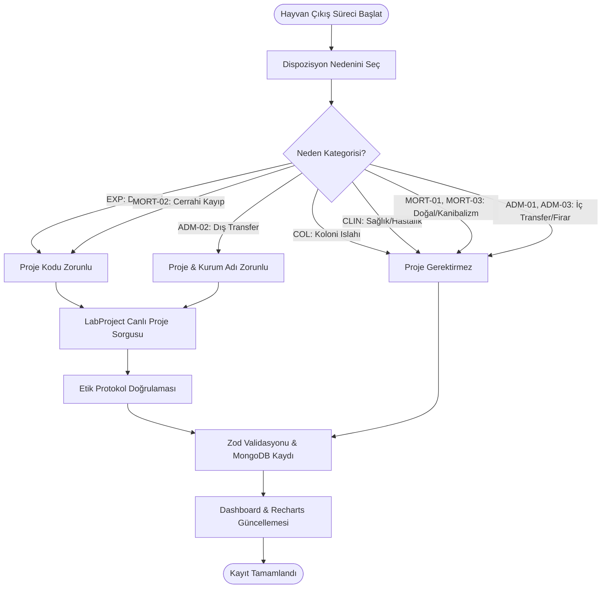
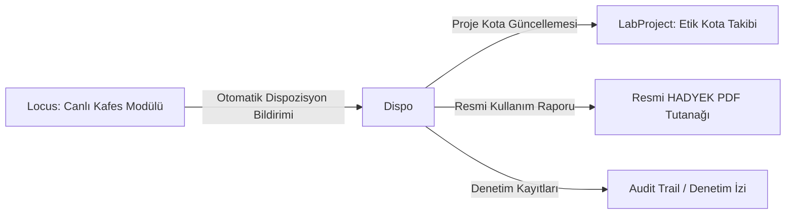

# Dispo - Vizyon, Domain Spesifikasyonu ve Faz Yol Haritası (Blueprint)

---

## 🌟 1. Ürün Vizyonu ve Felsefesi

**Dispo**, laboratuvar hayvanları araştırma ekosisteminde **"Final Disposition" (Nihai Akıbet / Çıkış Takibi)** süreçlerini bürokratik bir yük olmaktan çıkarıp **şeffaf, hatasız, denetlenebilir ve bilimsel etik standartlarına tam uyumlu** bir operasyona dönüştürmeyi hedefler.

Biyo-medikal araştırmalarda ve deney hayvanları ünitelerinde kullanılan her bir canlının yaşam döngüsü; doğumundan deney protokolüne, doku temininden damızlık emekliliğine kadar kayıt altına alınmak zorundadır. Dispo, Hayvan Deneyleri Yerel Etik Kurulları (HADYEK), Tarım ve Orman Bakanlığı denetimleri ve uluslararası akreditasyon (AAALAC) standartlarına uygun veri alt yapısı sunar.

### 1.1 Temel Değerler
1. **Sıfır Veri Kaybı ve Hesap Verebilirlik:** Koloniden çıkan tek bir hayvan bile gerekçesiz ve kayıtsız kalamaz.
2. **Kullanıcı Dostu Hız:** Araştırmacının veya veteriner teknisyeninin günlük rutinini aksatmayacak akıllı otomatik tamamlama ve asgari tıklama ile veri girişi.
3. **Önleyici Doğrulama:** Hatalı veri girişini sunucu seviyesinde engelleyen Zod şemaları ve iş mantığı kuralları.
4. **Ekosistem Sinerjisi:** Apex SSO ortak oturumu ve LabProject etik onay mekanizmasıyla tam entegrasyon.

---

## 🏛️ 2. Mimari Tasarım İlkeleri

- **Apex Hub & Spoke:** Dispo, tek başına bir kullanıcı tablosu yönetmez; yetkilendirme ve profil yönetimini merkezi Apex Hub'a delege eder.
- **Çoklu Veritabanı Ayrışımı (Domain Separation):** Hayvan dispozisyon verileri `Dispo_db`, etik proje kotaları `LabProject_db`, kullanıcı rolleri ise `Apex_db` üzerinde bağımsız tutulur.
- **Stateless & Serverless:** Vercel Serverless Functions üzerinde durumsuz mimari ile çalışır; ani yük artışlarında yatayda sıfır gecikmeyle ölçeklenir.
- **Güvenli Çift Yönlü İzolasyon:** Test ve önizleme ortamlarında `_test` veritabanları dinamik olarak seçilerek üretim verisinin kirlenmesi imkansız kılınır.

---

## 🧬 3. İş Mantığı ve Domain Kuralları

### 3.1 Neden Kategorileri ve Etik Kurul Eşlemesi
1. **Deneysel Nedenler (EXP-01 .. EXP-04):** Doğrudan bir HADYEK onaylı proje protokolüne bağlıdır. Yapılan her çıkış, ilgili projenin hayvan kotasından düşülür.
2. **Üretim ve Koloni Yönetimi (COL-01 .. COL-05):** Deney öncesi safhada damızlık emekliliği, cinsiyet fazlası, sütten kesim fazlası veya genotip uyuşmazlığı nedeniyle yapılan elemelerdir. Koloni refahını ve genetik saflığı korumayı amaçlar.
3. **Klinik ve Sağlık (CLIN-01 .. CLIN-05):** Deney protokolünden bağımsız gelişen hastalık, yaralanma veya mihmandar (sentinel) sağlık taramalarını kapsar.
4. **Spontan Ölümler (MORT-01 .. MORT-03):** Beklenmedik kafes içi ölümler veya cerrahi anestezi kayıplarıdır.
5. **İdari ve Lojistik (ADM-01 .. ADM-03):** Kurum içi/dışı devir ve kayıp durumlarını kayıt altına alır.

---

## 🗺️ 4. Tamamlanan Fazlar ve Yol Haritası (Roadmap)

### ✅ Faz 1: Temel Çıkış Yönetimi ve Raporlama (Tamamlandı)
- [x] Temel hayvan çıkış kaydı ekleme, silme ve listeleme arayüzü.
- [x] Temel göstergeler: Toplam çıkarılan hayvan, aylık çıkış ve proje sonlandırmaları.
- [x] JSON formatında tekil dışa aktarma (export) desteği.

### ✅ Faz 2: Standardizasyon, Doğrulama ve Yönlendirme (Tamamlandı)
- [x] **Apex SSO Entegrasyonu:** `interapp_session` HttpOnly JWT çerezi ile tek noktadan oturum kontrolü.
- [x] **URL Tabanlı Navigasyon:** `react-router-dom` v7 ile `/` (Kayıt/Liste) ve `/dashboard` (Analiz) rotalarının ayrılması.
- [x] **Sunucu Tarafı Zod Validasyonu:** `animalPostSchema` ile tüm istek gövdelerinin doğrulanması, tip güvenliği ve hatalı veri reddi.
- [x] **Cinsiyet Standardizasyonu:** DB seviyesinde `Male`/`Female` tutarlılığı, arayüzde Türkçe `Erkek` ♂ / `Dişi` ♀ etiketleri ve renkli simgeler.

### ✅ Faz 3: Etik Kota Entegrasyonu, Toplu Veri Transferi ve Gelişmiş Analitik (Tamamlandı)
- [x] **LabProject Entegrasyonu:**
  - `projects-search.js` üzerinden 500ms debounced canlı proje kodu ve başlığı araması.
  - `project-details.js` üzerinden tablodaki proje koduna tıklandığında açılan detay kartı (Proje Başlığı, PI, Protokol No, Durum).
- [x] **Toplu Veri İçe Aktarma (Batch Import):**
  - Backend `POST /api/animals` ucunda 2000 kayda kadar toplu Zod doğrulama desteği (`insertedCount`, `errorCount`).
  - İstemci tarafında `DataTransfer.jsx` bileşeni ile 500'erlik paketleme (chunking), ilerleme çubuğu ve veri temizliği.
- [x] **Recharts ile Aylık Çıkarılma Analizi:**
  - 12 takvim ayına normalize edilmiş yığılmış (stacked) bar grafik.
  - Kategori (`CAT:EXP`, `CAT:COL` vb.) ve tekil kod bazında dinamik filtreleme ve toplam içindeki yüzde hesaplaması.
- [x] **Sütun Bazlı Filtreleme ve Esnek Sayfalama:**
  - Tarih, tür/suş, cinsiyet ve neden kodlarında açılır pencere (popover) filtreleri.
  - Sayfa başına 50, 100, 500 satır görüntüleme desteği.

---

### 🚀 Faz 4: Gelişmiş Ekosistem Entegrasyonları ve Denetim (Planlanan)

- [ ] **Locus (Kafes Konum) Entegrasyonu:**
  - Kafes barkodu okutulduğunda kafesteki hayvanların otomatik olarak Dispo formuna aktarılması.
  - Dispo'da çıkışı yapılan hayvanın Locus üzerinde anında kafes mevcudundan düşürülmesi.
- [ ] **Resmi HADYEK PDF Raporlama:**
  - Tarih aralığı ve proje bazında resmi formatta "Hayvan Kullanım ve İmha Tutanağı" PDF çıktısı alabilme.
  - Yürütücü ve veteriner hekim imza bloklarının otomatik oluşturulması.
- [ ] **Audit Trail (Kayıt Denetim İzi):**
  - Kayıt silme, düzeltme ve toplu aktarma işlemlerinde kimin, ne zaman işlem yaptığının `audit_logs` koleksiyonunda saklanması.
- [ ] **Otomatik Kota Aşım Uyarıları:**
  - Proje etik onayında belirlenen toplam hayvan sayısına yaklaşıldığında (%80) sarı, dolduğunda (%100) kırmızı uyarı bayrakları.
