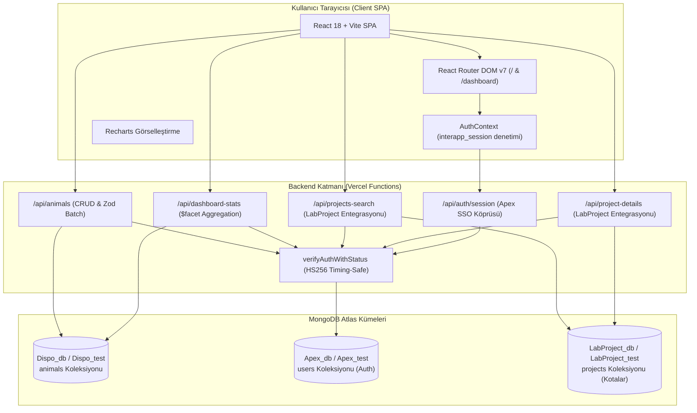
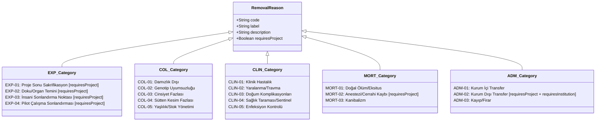

# Dispo - Teknik Mimari ve Sistem Spesifikasyonu

Bu doküman, **Dispo (Laboratory Colony Disposition Manager)** uygulamasının sistem mimarisini, veritabanı şemalarını, tam API referansını, bileşen hiyerarşisini ve güvenlik protokollerini en ince ayrıntısına kadar açıklar.

---

## 🏗️ 1. Sistem Mimarisi ve Ekosistem İlişkisi

Dispo, Antigravity ekosisteminin **Apex Hub & Spoke** mimarisi içerisinde durumsuz (stateless) çalışan bir mikro-uygulamadır.



### 1.1 Çevreye Duyarlı Veritabanı ve Çerez İsimlendirmesi
`lib/mongodb.js` içerisinde tanımlanan yardımcı işlevler ile ortam otomatik algılanır:
- `isProdEnv()`: `process.env.VERCEL_ENV === 'production' || process.env.FORCE_PROD_DB === 'true'`
- `getDbName(baseName)`: Üretimde `baseName` (örn. `Dispo_db`, `Apex_db`, `LabProject_db`), test/önizlemede `_test` son eki alır (örn. `Dispo_test`, `Apex_test`, `LabProject_test`).
- `getSessionCookieName()`: Üretimde `interapp_session`, test/önizleme ortamlarında `interapp_session_test`.

---

## 📂 2. Derinlemesine Dizin Yapısı

```
Dispo/
├── api/                           # Vercel Serverless API Rotaları
│   ├── auth/
│   │   └── session.js             # GET: Oturum doğrula, POST/DELETE: Çerezi sil
│   ├── animals.js                 # GET: Hayvan listesi, POST: Tekil/Toplu kayıt, DELETE: Kayıt sil
│   ├── dashboard-stats.js         # GET: $facet pipeline ile yıllık, aylık, EXP-01 ve 12 aylık döküm
│   ├── projects-search.js         # GET: LabProject_db üzerinde regex bazlı proje arama (min 2 karakter)
│   └── project-details.js         # GET: LabProject_db üzerinde etik koduna göre proje künyesi getirme
├── lib/                           # Paylaşılan Çekirdek Sunucu Kütüphaneleri
│   ├── auth.js                    # JWT HS256 timing-safe doğrulama, cookie silme ve app yetki kontrolü
│   └── mongodb.js                 # MongoClient havuzu (HMR uyumlu) ve çoklu ortam db eşleyicisi
├── src/                           # React İstemci Kodları
│   ├── components/                # Arayüz Bileşenleri
│   │   ├── Dashboard.jsx          # Analiz paneli, StatsCard'lar ve DashboardChart entegrasyonu
│   │   ├── DashboardChart.jsx     # Recharts Stacked Bar, dinamik filtreleme ve custom tooltip
│   │   ├── DataTransfer.jsx       # JSON içe aktarma (500'lük chunking) ve JSON dışa aktarma modalı
│   │   ├── EntryForm.jsx          # Hayvan çıkış formu, otomatik tamamlama ve şartlı alanlar
│   │   ├── Layout.jsx             # Ortak başlık barı, Apex linki, navigasyon ve çıkış butonu
│   │   ├── RecordList.jsx         # Çoklu sütun filtreli tablo, sayfalama ve proje detay popup'ı
│   │   └── StatsCard.jsx          # Renkli istatistik kutusu bileşeni
│   ├── context/
│   │   └── AuthContext.jsx        # SSO kimlik denetimi, dev mode bypass ve Apex yönlendirmeleri
│   ├── lib/
│   │   ├── constants.js           # Tür/suş haritası ve 17 adet dispozisyon nedeni (requiresProject bayrakları)
│   │   └── db.js                  # Frontend API sarmalayıcısı (toArray, add, bulkAdd, delete)
│   ├── App.jsx                    # React Router DOM v7 rotalama, durum yönetimi ve HomeView
│   ├── main.jsx                   # React 18 createRoot başlatıcısı
│   └── index.css                  # Tailwind CSS direktifleri ve temel stiller
├── index.html                     # HTML5 ana şablonu
├── package.json                   # Bağımlılıklar (React 18, RR v7, Zod v4, Recharts v3 vb.)
├── postcss.config.js              # PostCSS Tailwind & Autoprefixer eklentileri
├── tailwind.config.js             # Tailwind CSS içerik yolları ve tema ayarları
├── vercel.json                    # SPA URL yönlendirme (rewrite) kuralı
└── vite.config.js                 # Vite + özel Vercel serverless geliştirme middleware'i
```

---

## 🗄️ 3. Veritabanı ve Şema Spesifikasyonu

Dispo üç ayrı veritabanı kümesi ile haberleşir.

### 3.1 `Dispo_db.animals` Koleksiyonu
Uygulamanın ana veri deposudur. Her bir çıkarılan hayvan grubu bu koleksiyonda saklanır.

| Alan Adı | MongoDB Tipi | Zod Tipi | Zorunlu? | Açıklama / Değer Havuzu |
|---|---|---|---|---|
| `_id` | `ObjectId` | - | Otomatik | Benzersiz MongoDB doküman kimliği |
| `species` | `string` | `z.string().min(1)` | Evet | Tür: `"Fare"`, `"Sıçan"`, `"Tavşan"` |
| `strain` | `string` | `z.string().min(1)` | Evet | Suş: `"BALB/c"`, `"C57BL/6"`, `"Wistar"`, `"Sprague Dawley"` vb. |
| `sex` | `string` | `z.string().min(1)` | Evet | Cinsiyet: Arayüzden `"Erkek"` veya `"Dişi"`, DB'de `"Male"` veya `"Female"` normalize edilir |
| `count` | `number` (int) | `z.coerce.number().int().positive()` | Evet | Çıkarılan hayvan adedi (pozitif tam sayı) |
| `dob` | `string` | `z.string().min(1)` | Evet | Doğum Tarihi (`YYYY-MM-DD`) |
| `removalDate` | `string` | `z.string().min(1)` | Evet | Çıkarılma Tarihi (`YYYY-MM-DD`) |
| `reason` | `string` | `z.string().min(1)` | Evet | Dispozisyon Neden Kodu (örn. `"EXP-01"`, `"COL-03"`) |
| `project` | `string` | `z.string().optional().default('-')`| Hayır | İlişkili proje kodu (örn. `"2025/12-3"` veya `"-"`) |
| `transferInstitution` | `string \| null` | `z.string().nullable().optional()`| Hayır | Kurum dışı transferde hedef kurum adı (örn. `"X Üniversitesi"`) |

### 3.2 `LabProject_db.projects` Koleksiyonu (Entegre Okuma)
Dispo, etik projelerle ilişkilendirme ve doğrulama için bu koleksiyona salt okunur erişir:
- `code` (`string`): Proje etik onay numarası / kodu (örn. `"2024/05-1"`). İndeksli alandır.
- `title` (`string`): Projenin tam bilimsel başlığı.
- `pi` (`string`): Proje Yürütücüsü (Principal Investigator).
- `protocol` (`string`): Etik kurul protokol referans numarası.
- `status` (`string`): Proje durumu (`"Active"`, `"Continuing"`, `"Completed"`).

### 3.3 `Apex_db.users` Koleksiyonu (Kimlik Doğrulama)
- `email` (`string`): Kullanıcı e-posta adresi (benzersiz).
- `role` (`string`): Kullanıcı rolü (`"admin"`, `"user"` vb.).
- `apps` (`Array<string>`): Kullanıcının erişebileceği uygulamalar (örn. `["dispo", "circa", "locus"]`).
- `name` (`string`): Kullanıcı adı soyadı.

---

## 📋 4. Çıkarılma Nedenleri (Disposition Codes) ve İş Kuralları

Sistemde tanımlı 17 adet dispozisyon kodu 5 ana kategoride toplanmıştır:



> [!IMPORTANT]
> **Proje Zorunluluğu Kuralı:** `EXP-01`, `EXP-02`, `EXP-03`, `EXP-04`, `MORT-02` ve `ADM-02` kodları seçildiğinde `requiresProject: true` tetiklenir ve formda `project` girişi zorunlu kılınır. `ADM-02` seçildiğinde ek olarak `transferInstitution` zorunlu hale gelir.

---

## 🔌 5. Tam API Referansı

Tüm API uçları `interapp_session` JWT çerezini doğrular. Çerez geçersizse `401 Unauthorized`, kullanıcının `apps` listesinde `'dispo'` yoksa ve rolü `'admin'` değilse `403 Forbidden` döner.

---

### 5.1 Hayvan Kayıtları API — `/api/animals`

#### A) GET `/api/animals`
Tüm hayvan çıkış kayıtlarını `removalDate` tarihine göre azalan (en yeniden eskiye) sırada listeler.

- **İstek:** `GET /api/animals`
- **Yetki:** `dispo` uygulaması yetkisi veya `admin` rolü.
- **Başarılı Yanıt (200 OK):**
```json
[
  {
    "id": "664fa789b1c2e3f4a5b6c7d8",
    "species": "Fare",
    "strain": "C57BL/6",
    "sex": "Erkek",
    "count": 5,
    "dob": "2024-01-15",
    "removalDate": "2024-05-20",
    "reason": "EXP-01",
    "project": "2024/05-1",
    "transferInstitution": null
  }
]
```

---

#### B) POST `/api/animals` (Tekil veya Toplu Ekleme)
Tek bir hayvan kaydı veya toplu kayıt dizisi ekler. Sunucuda Zod şeması ile tam denetim yapılır.

**Tekil Kayıt İstek Gövdesi:**
```json
{
  "species": "Fare",
  "strain": "BALB/c",
  "sex": "Dişi",
  "count": 3,
  "dob": "2024-02-10",
  "removalDate": "2024-06-01",
  "reason": "COL-03",
  "project": "-",
  "transferInstitution": null
}
```
**Tekil Kayıt Başarılı Yanıt (201 Created):**
```json
{
  "id": "6650b89ac2d3e4f5a6b7c8d9",
  "species": "Fare",
  "strain": "BALB/c",
  "sex": "Dişi",
  "count": 3,
  "dob": "2024-02-10",
  "removalDate": "2024-06-01",
  "reason": "COL-03",
  "project": "-",
  "transferInstitution": null
}
```

**Toplu (Batch) Kayıt İstek Gövdesi:**
İstek gövdesi doğrudan bir dizi `[...]` veya `{ "items": [...] }` formatında olabilir. Maksimum 2000 kayıt kabul edilir.
```json
{
  "items": [
    {
      "species": "Fare",
      "strain": "C57BL/6",
      "sex": "Erkek",
      "count": 2,
      "dob": "2024-03-01",
      "removalDate": "2024-06-02",
      "reason": "EXP-02",
      "project": "2024/05-1"
    }
  ]
}
```
**Toplu Kayıt Başarılı Yanıt (201 Created):**
```json
{
  "insertedCount": 1,
  "errorCount": 0
}
```

**Hata Yanıtları:**
- `400 Bad Request`: `{"error": "Miktar pozitif bir tam sayı olmalıdır."}` veya `{"error": "Tek seferde en fazla 2000 kayıt aktarılabilir."}`
- `401 / 403`: Oturum veya yetki hatası.
- `500 Internal Server Error`: `{"error": "Hata açıklaması"}`

---

#### C) DELETE `/api/animals?id={id}`
Belirtilen `ObjectId`'ye sahip kaydı siler.

- **Query Parametreleri:** `id` (`string`, geçerli 24 karakterli hex ObjectId).
- **Başarılı Yanıt (200 OK):**
```json
{
  "success": true
}
```
- **Hata Yanıtı (400 Bad Request):**
```json
{
  "error": "Geçerli bir kayıt ID gereklidir."
}
```

---

### 5.2 Dashboard İstatistikleri — `/api/dashboard-stats`
Dashboard özet kartları ve Recharts grafiği için MongoDB `$facet` agregasyonunu çalıştırır.

- **İstek:** `GET /api/dashboard-stats`
- **Yetki:** `dispo` erişimi.
- **Agregasyon Detayı:**
  - `yearCount`: `removalDate >= "${currentYear}-01-01"` olan kayıtların `count` toplamı.
  - `monthCount`: `removalDate >= "${currentYear}-${currentMonth}-01"` olan kayıtların `count` toplamı.
  - `projectTerminationCount`: `reason == "EXP-01"` olan kayıtların `count` toplamı.
  - `monthlyData`: Yıl başından itibaren aylara göre gruplanıp (`$substr: ["$removalDate", 5, 2]`) neden kodları bazında dağıtılan ve 12 takvim ayına normalize edilen veri dizisi.
- **Başarılı Yanıt (200 OK):**
```json
{
  "year": 142,
  "month": 28,
  "projectTermination": 64,
  "monthlyData": [
    {
      "month": "01",
      "total": 35,
      "reasons": {
        "EXP-01": 20,
        "COL-01": 15
      }
    },
    {
      "month": "02",
      "total": 0,
      "reasons": {}
    }
  ]
}
```

---

### 5.3 Proje Canlı Arama — `/api/projects-search`
Kullanıcı kayıt formunda proje kodu yazarken otomatik tamamlama önerileri sunar.

- **İstek:** `GET /api/projects-search?q={query}`
- **Query Parametreleri:** `q` (`string`, minimum 2 karakter).
- **Mantık:** Regex enjeksiyonunu engellemek için `escapeRegExp` uygulanır; `LabProject_db.projects` içinde `code` veya `title` alanlarında büyük/küçük harf duyarsız (`$options: 'i'`) arama yapılır. En fazla 10 sonuç döner.
- **Başarılı Yanıt (200 OK):**
```json
[
  {
    "_id": "65b8f1a23c4d5e6f7a8b9c01",
    "code": "2024/05-1",
    "title": "Nörodejeneratif Hastalıklarda Hücresel Tedavi Modelleri"
  }
]
```

---

### 5.4 Proje Detay Künyesi — `/api/project-details`
Tablodaki bir proje koduna tıklandığında projenin künyesini getirir.

- **İstek:** `GET /api/project-details?code={code}`
- **Query Parametreleri:** `code` (`string`, zorunlu).
- **Mantık:** `LabProject_db.projects` koleksiyonunda `{ code: code }` tam eşleşmesi aranır.
- **Başarılı Yanıt (200 OK):**
```json
{
  "title": "Nörodejeneratif Hastalıklarda Hücresel Tedavi Modelleri",
  "pi": "Prof. Dr. Ahmet Yılmaz",
  "code": "2024/05-1",
  "protocol": "HADYEK-2024-88",
  "status": "Active"
}
```
- **Hata Yanıtı (404 Not Found):**
```json
{
  "error": "Bu etik numarasına ait proje bulunamadı."
}
```

---

### 5.5 Oturum ve Yetkilendirme — `/api/auth/session`

- **GET `/api/auth/session`**: Mevcut çerezi doğrular.
  - Başarılı Yanıt (200 OK):
    ```json
    {
      "email": "oguzhan@wildtype.app",
      "name": "Oguzhan",
      "role": "admin",
      "apps": ["dispo", "circa", "locus"]
    }
    ```
  - Yetki Yok (403 Forbidden):
    ```json
    {
      "error": "Bu uygulamaya erişim yetkiniz bulunmamaktadır."
    }
    ```
- **POST / DELETE `/api/auth/session`**: Çerezi sıfırlar (`Max-Age=0`).
  - Yanıt (200 OK): `{"message": "Logged out"}`

---

## 💻 6. Frontend Mimarisi ve Rota Tablosu

### 6.1 React Router Rotaları
`react-router-dom` v7 ile yapılandırılmıştır. Tüm rotalar `Layout` bileşeni ile sarmalanır.

| URL Yolu | Bileşen | Açıklama |
|---|---|---|
| `/` | `HomeView` | Ana sayfa: Kayıt Ekleme Formu (`EntryForm`), Özet Kartlar (`StatsCard`), Filtreli Liste (`RecordList`) ve Veri Aktarımı modalı (`DataTransfer`) |
| `/dashboard` | `Dashboard` | Analiz paneli: Yıllık/aylık metrikler ve interaktif Recharts aylık trend grafiği (`DashboardChart`) |

### 6.2 Bileşenler Arası Veri Akışı
1. `App.jsx`, açılışta `db.animals.toArray()` çağrısı yaparak `records` durumunu (state) doldurur.
2. `useMemo` kancaları ile `filteredRecords` (metin araması eşleşmeleri) ve yerel `stats` (toplam, bu ay, proje kullanımı) türetilir.
3. Bir kayıt eklendiğinde (`onRecordAdded`) veya silindiğinde (`onDelete`), `fetchRecords()` tetiklenerek liste ve istatistikler anında güncellenir.
4. `RecordList.jsx` kendi içinde çoklu sütun popover filtrelerini ve sayfalama (`pagination.currentPage`, `itemsPerPage: 50/100/500`) mantığını yönetir.
5. `DataTransfer.jsx` 500'lük paketler (`CHUNK_SIZE = 500`) halinde `db.animals.bulkAdd()` çağırarak toplu verileri parçalı yükler; ilerleme çubuğunu günceller.

---

## ⚙️ 7. Ortam Değişkenleri (.env)

| Değişken Adı | Zorunlu? | Varsayılan | Açıklama |
|---|---|---|---|
| `MONGODB_URI` | **Evet** | - | MongoDB Atlas bağlantı dizesi |
| `JWT_SECRET` | **Evet** | - | Apex SSO ortak JWT imzalama anahtarı (en az 32 karakter) |
| `VERCEL_ENV` | Hayır | `development` | Vercel tarafından sağlanan çalışma ortamı (`production`, `preview`, `development`) |
| `FORCE_PROD_DB`| Hayır | `false` | `true` yapılırsa geliştirme ortamında da `_db` veritabanlarına bağlanır |

---

## 🛡️ 8. Güvenlik ve Hata Yönetimi Protokolleri

1. **Sabit Zamanlı İmza Doğrulaması:** `crypto.timingSafeEqual` kullanılarak JWT imzaları kıyaslanır; zamanlama saldırıları (timing attack) kesin olarak engellenir.
2. **SameSite ve HttpOnly Güvenliği:** Oturum çerezleri istemci betiklerine kapalıdır; CSRF saldırılarına karşı `SameSite=Lax` ile korunur.
3. **ReDoS Koruması:** Proje arama ucunda gelen kullanıcı girdisi `escapeRegExp` fonksiyonundan geçirilerek Regex DoS ve NoSQL injection ihtimalleri bertaraf edilir.
4. **Zod Tip Zorlaması ve Ayıklama:** Gelen veriler Zod ile doğrulanırken sayısal veriler `z.coerce.number().int().positive()` ile güvenli tam sayıya dönüştürülür.
5. **Geliştirici Dostu Yerel Mock:** Yerel geliştirmede (`import.meta.env.DEV`), `AuthContext` geliştiricileri engellememek için otomatik olarak simüle edilmiş kullanıcı döndürür; üretimde ise kesinlikle `/api/auth/session` üzerinden doğrulanır.
